# Launcher

Launcher Android com cinco temas inspirados em sistemas de desktop e mobile: **Windows, Ubuntu,
KDE Plasma, macOS e iOS**. Cada tema muda não só as cores, mas também a forma de navegar:
posição do dock, menu de apps, barras e componentes. Favoritos, pastas, dock e widgets são
preservados ao trocar de tema.

O conceito completo está em [`docs/conceito.md`](docs/conceito.md).

**Baixar APK:** [`releases/launcher.apk`](releases/launcher.apk)

## Temas

| Windows | Ubuntu | KDE Plasma | macOS | iOS |
| --- | --- | --- | --- | --- |
| 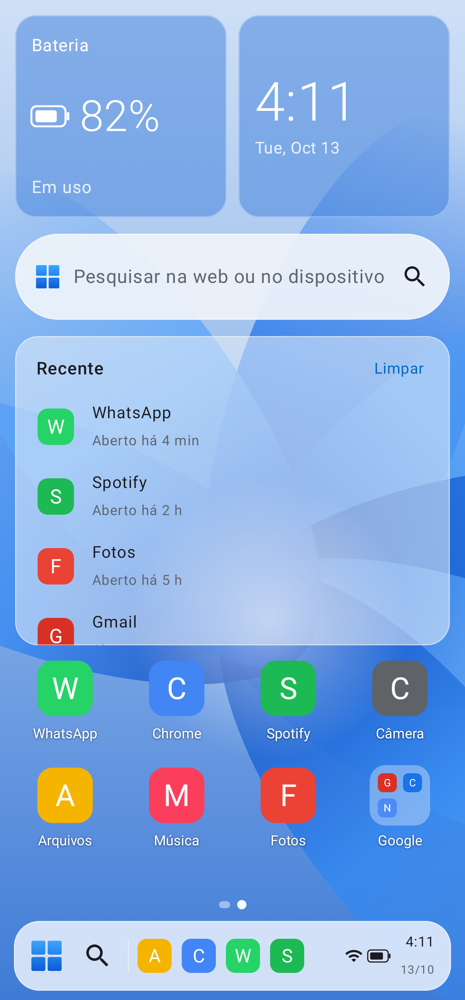 | 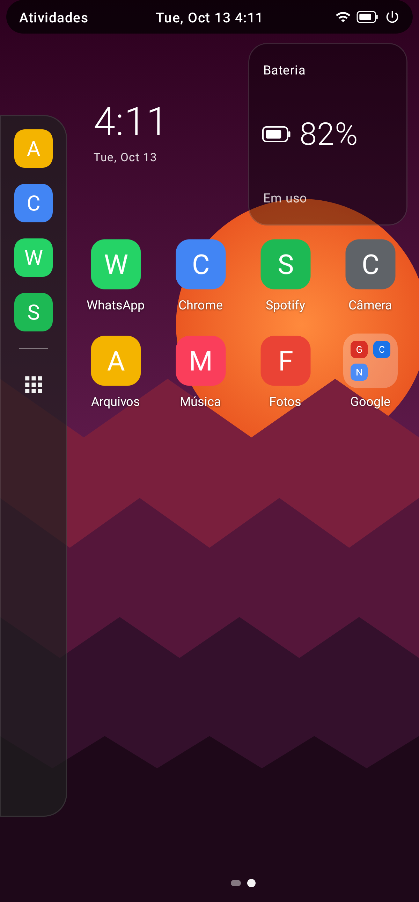 | 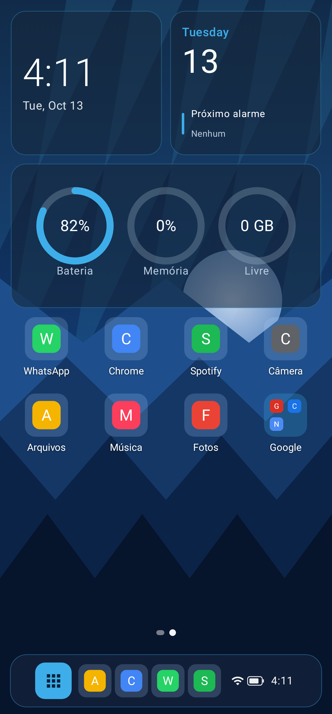 | 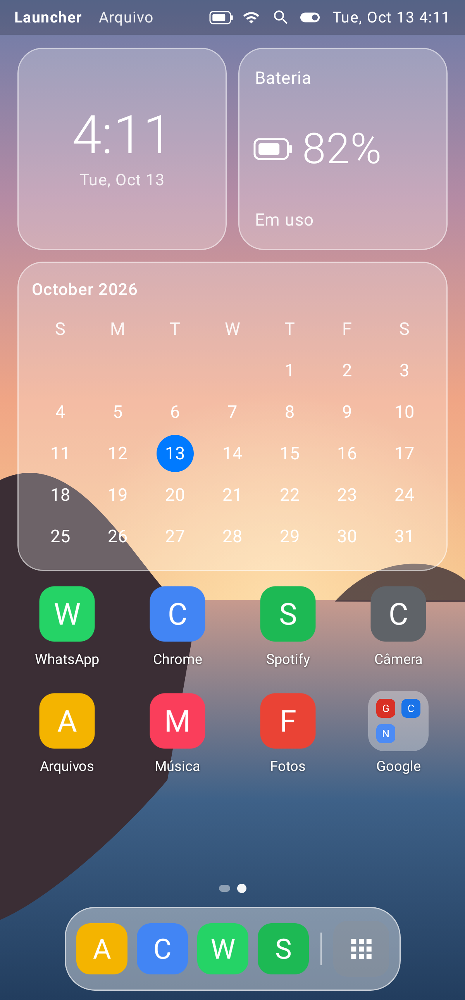 | 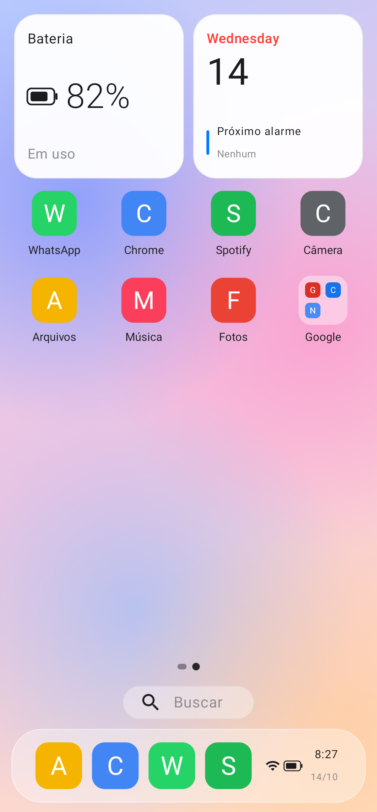 |
| 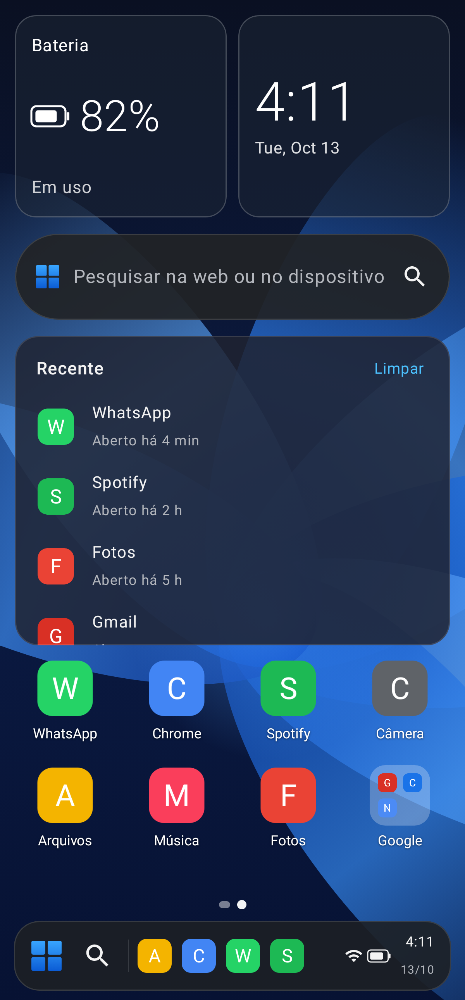 | 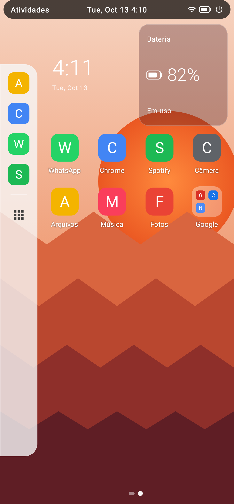 | 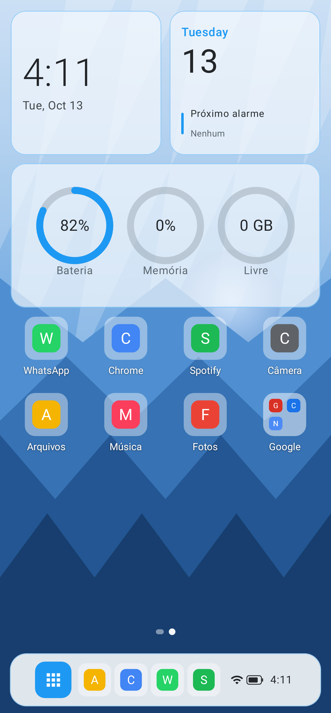 | 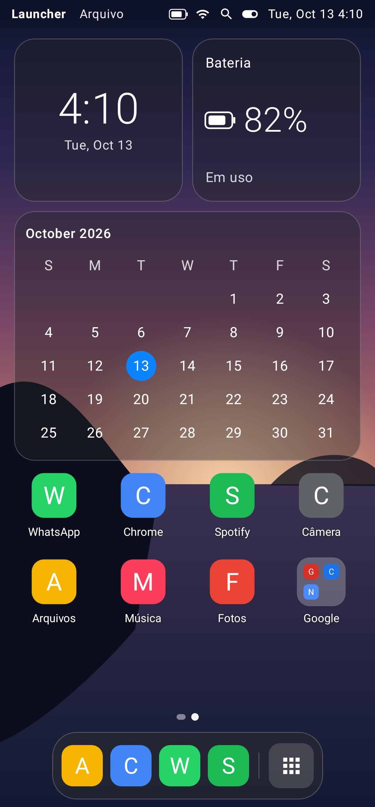 | 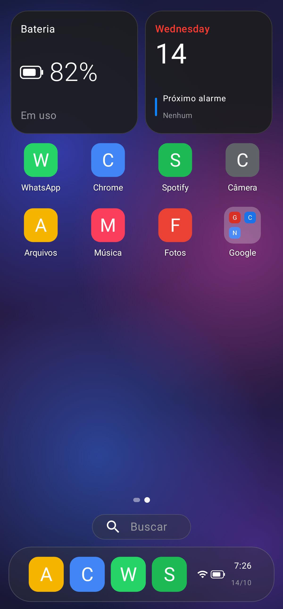 |
| 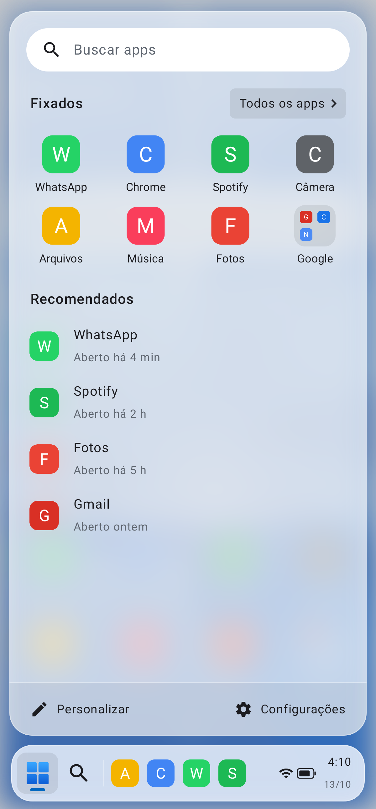 | 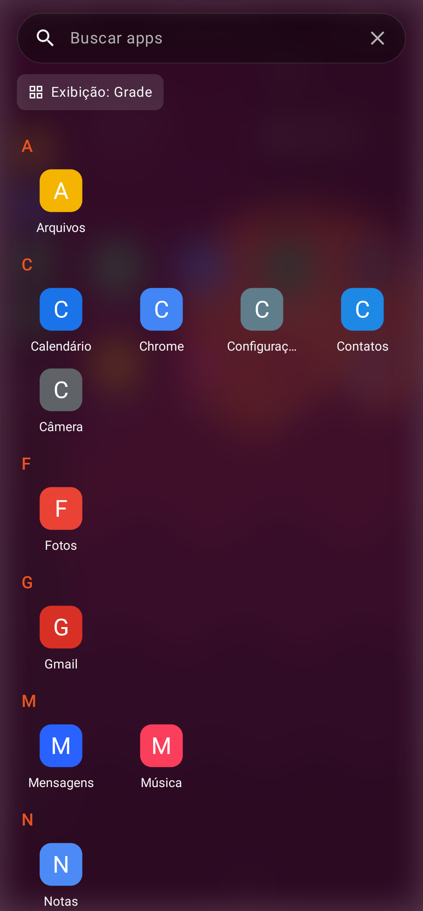 | 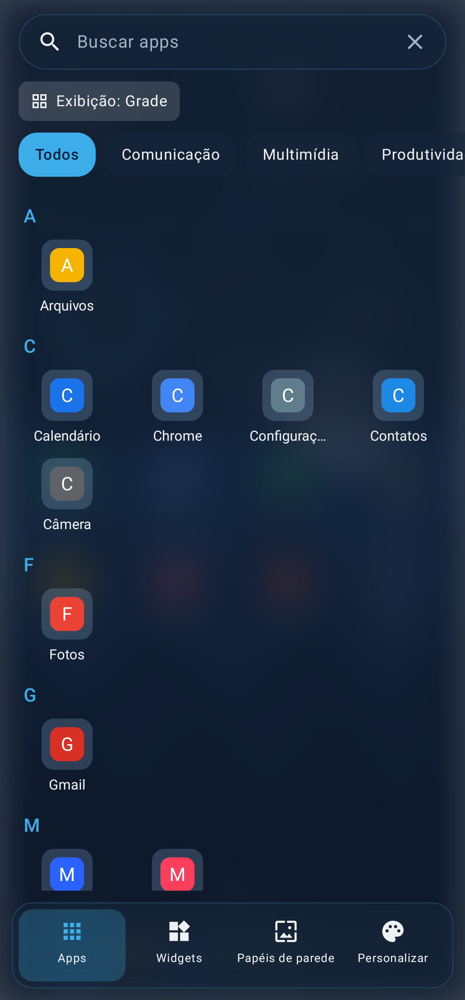 | 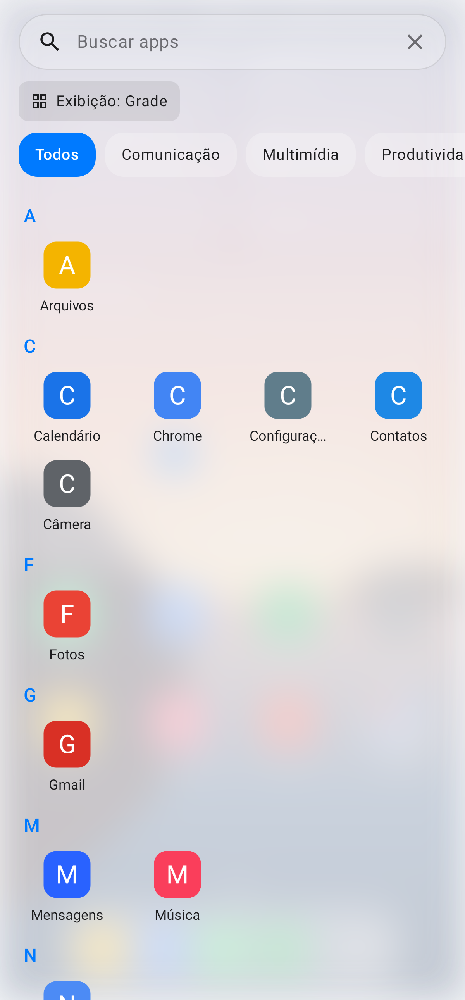 | 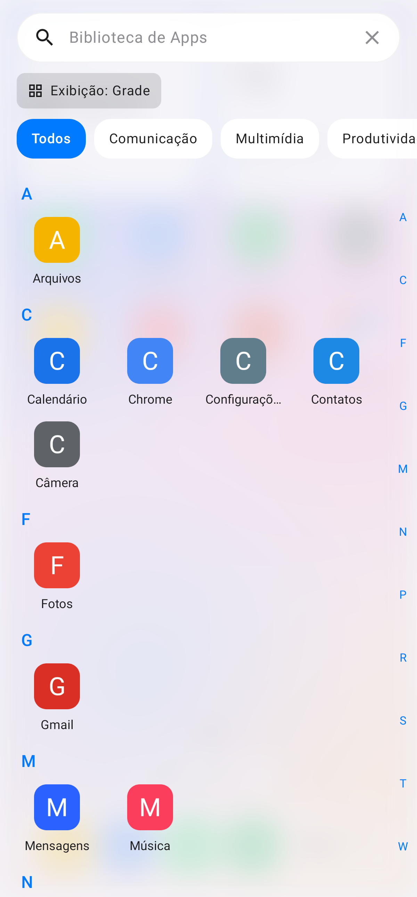 |

| Iniciar translúcido | Todos os apps: categoria | Todos os apps: grade | Organizar | Painel de controle |
| --- | --- | --- | --- | --- |
| 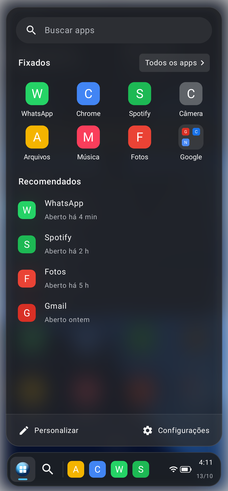 | 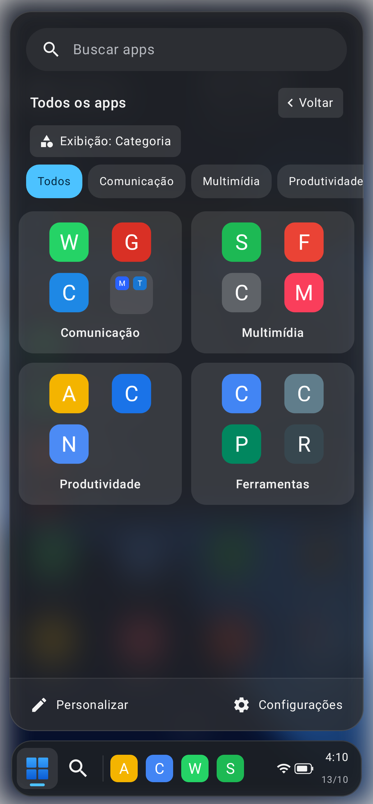 | 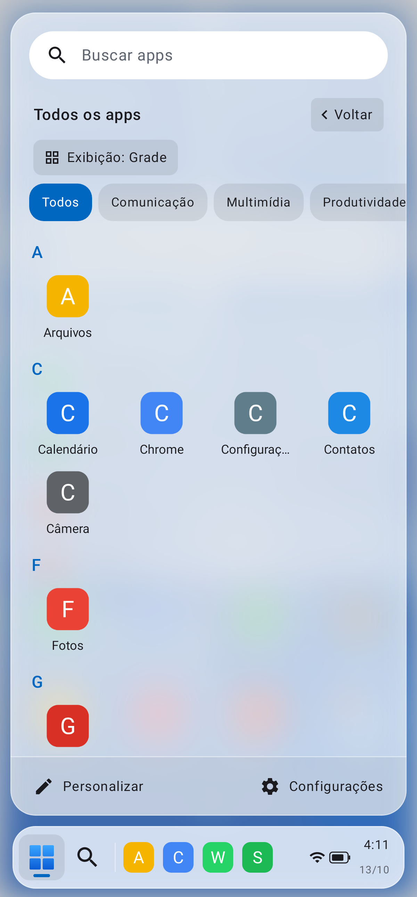 | 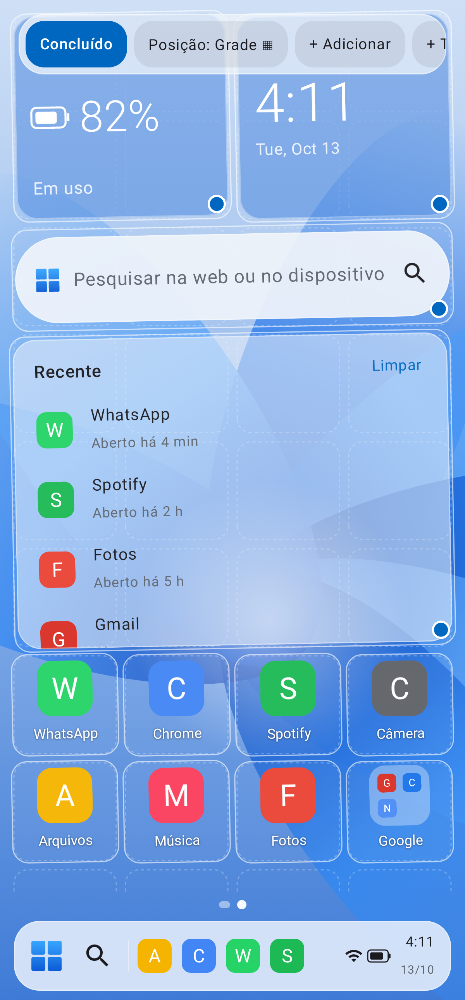 | 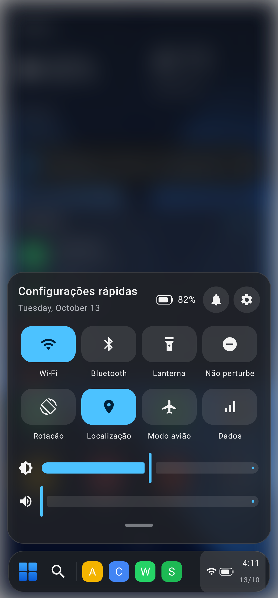 |

_Capturas geradas pelos testes de screenshot com apps de exemplo._

- **Windows:** barra de tarefas com Iniciar, busca, apps e bandeja (abre as configurações
  rápidas); Menu Iniciar com Fixados, Todos os apps, Recomendados e busca; cartão "Recente".
- **Ubuntu:** barra superior com Atividades e menu do sistema, dock lateral de favoritos e
  grade de aplicativos.
- **KDE Plasma:** monitor do sistema (bateria, memória, armazenamento), ícones em blocos,
  painel flutuante e lançador com categorias e abas.
- **macOS:** barra de menus com Spotlight e Central de Controle, calendário, Dock e Launchpad.
- **iOS:** widgets grandes, várias telas, busca acima do dock e Biblioteca de Apps com índice A–Z.

## Recursos

- **Modo claro, escuro ou seguir o sistema**, em todos os temas e na tela de ajustes.
- **Área de trabalho organizável:** toque longo no fundo → *Organizar área de trabalho*.
  Arraste itens, redimensione widgets e componentes pelo ponto no canto, remova ou mova de tela.
  - **Grade:** os itens se encaixam nas células.
  - **Livre:** os itens ficam onde você soltar, como na área de trabalho do Windows.
- **Várias telas** (opcional), alternadas deslizando para o lado.
- **Painel de controle:** Wi-Fi, Bluetooth, lanterna, Não perturbe, rotação, localização, modo
  avião, dados, brilho, volume e atalho para as notificações do sistema.
- **Gestos do launcher:** deslizar para cima abre o menu de apps; deslizar para baixo abre o
  painel de controle, as notificações ou a busca (configurável).
- **Papel de parede animado:** toques em áreas vazias são repassados a ele, e a troca de telas
  envia o deslocamento, como nos launchers do sistema. Desative o papel de parede do tema para vê-lo.
- **Ícone do menu de apps** configurável: padrão do tema, plano, orbe, grade ou uma imagem da galeria.
- **Todos os apps** em Categoria, Grade ou Lista (Iniciar e gavetas).
- **Efeitos de transparência:** menus e painéis translúcidos com o fundo desfocado (Android 12+).
- **Animações:** toque nos ícones, abertura de apps a partir do ícone, entrada escalonada nos
  menus, páginas do Iniciar deslizando, itens que tremem e deslizam no modo de edição, troca de
  tema com transição e tela de ajustes deslizando.
- **Tela à esquerda:** feed no estilo Discover, com notícias com imagem por assunto (g1, ge,
  BBC News Brasil, Tecmundo) e leitor de matérias dentro do launcher.
- **Iniciar abrindo direto em "Todos os apps"** (como no KDE), com filtros por categoria.
- **Toque longo em widgets e cartões:** remover, mover/redimensionar e configurar widget.
- **Barras opcionais:** ocultar a barra de tarefas/dock, só o fundo dela, ou a barra superior
  (Personalizar ou toque longo no fundo).
- **Importar a tela inicial do launcher do sistema** (apps, pastas, telas e dock), ou os apps
  mais usados quando o fabricante bloqueia a leitura.
- **Gestos do HyperOS/MIUI:** com a permissão `WRITE_SECURE_SETTINGS` concedida uma vez pelo ADB
  (`adb shell pm grant dev.jesiel.launcher android.permission.WRITE_SECURE_SETTINGS`), o Launcher
  libera os gestos de tela cheia sozinho (Personalizar → Gestos).
- Widgets Android, pastas, dock configurável, busca sem acentos, launcher padrão.

O Android não permite que apps liguem Wi-Fi ou Bluetooth diretamente; esses botões abrem o
painel do sistema. Brilho e rotação pedem a permissão "Alterar configurações do sistema", e
"Não perturbe" pede o acesso correspondente.

### Gestos de navegação do sistema

A navegação por gestos ou por botões é controlada pelo Android, não pelo launcher. No
Xiaomi/HyperOS os gestos de tela cheia só ficam disponíveis com o launcher de fábrica. Para
liberar, conceda a permissão acima pelo ADB (do computador, ou do próprio celular com Termux +
depuração sem fio, ou Shizuku) e ligue a opção em Personalizar → Gestos.

## Arquitetura

```
app/src/main/java/dev/jesiel/launcher/
├── data/        Apps instalados, preferências, grade e posições da área de trabalho
├── widgets/     AppWidgetHost para widgets Android
├── theme/       LauncherThemeSpec + ThemeRegistry: contrato que cada tema implementa
├── ui/common/   Área de trabalho, painel de controle, gaveta de apps, dock, cartões, paleta
├── ui/settings/ Tela "Personalizar"
└── ui/{windows,ubuntu,kde,macos,ios}/  Cada tema
```

Um tema define uma `LauncherPalette` (clara e escura), os componentes próprios (`BuiltinSpec`)
e a moldura (barras, dock, menus), e reaproveita `DesktopCanvas`, `AppDrawer` e `ControlCenter`.

## Compilar

Requer JDK 17+ e Android SDK 35.

```sh
./gradlew assembleRelease        # APK otimizado: app/build/outputs/apk/release/app-release.apk
./gradlew assembleDebug          # APK de depuração (mais lento)
./gradlew testDebugUnitTest      # testes
./gradlew recordRoborazziDebug   # regenera docs/screenshots
```
