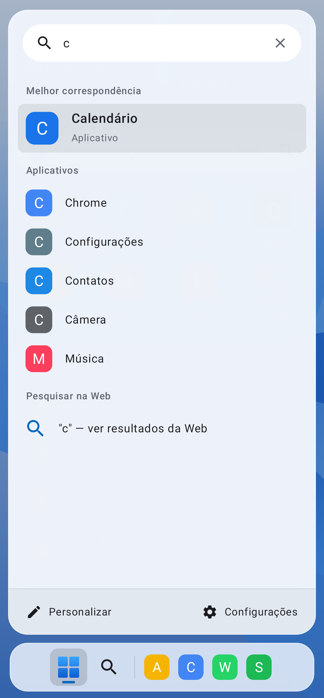
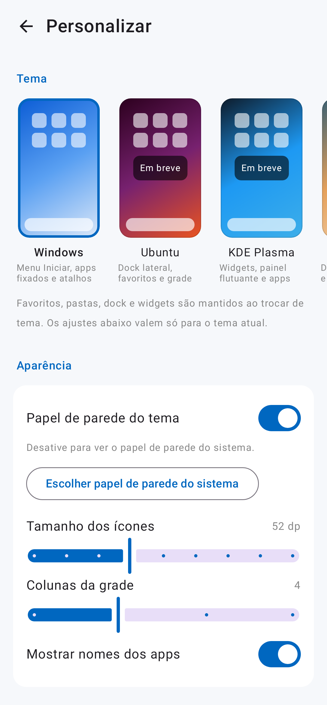

# Launcher

Launcher Android com múltiplos temas inspirados em sistemas de desktop e mobile. Cada tema muda
não só as cores, mas também a forma de navegar: posição do dock, menu de apps e disposição dos
widgets. Favoritos, pastas, dock e widgets são preservados ao trocar de tema.

O conceito completo está em [`docs/conceito.md`](docs/conceito.md).

## Primeiro tema: Windows

| Área de trabalho | Menu Iniciar | Todos os apps | Busca | Personalizar |
| --- | --- | --- | --- | --- |
|  |  |  |  |  |

_Capturas geradas pelos testes de screenshot com apps de exemplo._

- **Área de trabalho:** cartões de bateria e relógio, barra de pesquisa, widgets Android,
  apps fixados (com pastas) e cartão "Recente".
- **Barra de tarefas:** botão Iniciar, pesquisa e até 5 apps fixados.
- **Menu Iniciar:** busca de apps (ignora acentos) com atalho para pesquisa na Web,
  "Fixados", "Todos os apps" em ordem alfabética e "Recomendados".
- **Toque longo em um app:** fixar/desafixar na tela inicial ou na barra de tarefas, mover para
  pasta, reordenar, informações do app e desinstalar.
- **Toque longo na área de trabalho:** adicionar widget, papel de parede e personalização.
- **Personalizar:** seletor de tema com prévia, papel de parede (do tema ou do sistema), tamanho
  dos ícones, colunas da grade, nomes dos apps, widgets e definição como launcher padrão.

Os temas Ubuntu, KDE Plasma, macOS e iOS aparecem no seletor como "Em breve".

"Recente" e "Recomendados" mostram os apps abertos pelo próprio launcher, o que não exige
permissões especiais. Arquivos recentes e clima, como nos mockups, ficam para depois.

## Arquitetura

```
app/src/main/java/dev/jesiel/launcher/
├── data/        Apps instalados (LauncherApps, inclui perfil de trabalho) e preferências
├── widgets/     AppWidgetHost para widgets Android
├── theme/       LauncherThemeSpec + ThemeRegistry: contrato que cada tema implementa
├── ui/common/   Ícone de app com menu, pastas, widgets, busca
├── ui/settings/ Tela "Personalizar"
└── ui/windows/  Tema Windows: área de trabalho, barra de tarefas e Menu Iniciar
```

Um novo tema implementa `LauncherThemeSpec.Content(state, controller)` e é registrado em
`ThemeRegistry`. Ele recebe o mesmo `LauncherUiState` (apps, favoritos, pastas, dock, recentes,
widgets) e usa o `LauncherController` para abrir apps e ações do sistema.

## Compilar

Requer JDK 17+ e Android SDK 35.

```sh
./gradlew assembleDebug          # app/build/outputs/apk/debug/app-debug.apk
./gradlew testDebugUnitTest      # testes
./gradlew recordRoborazziDebug   # regenera docs/screenshots
```

O workflow do GitHub Actions também gera o APK de debug como artefato.
Depois de instalar, abra o app e toque em **Definir como padrão** em Personalizar.
