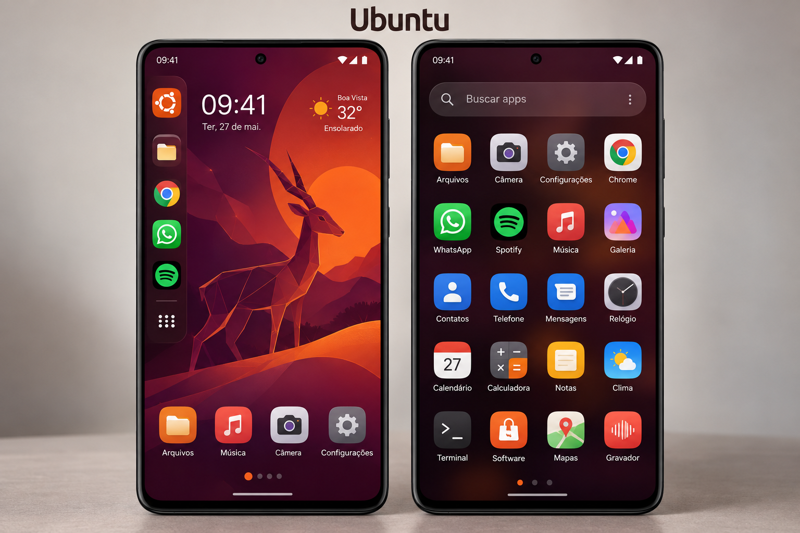
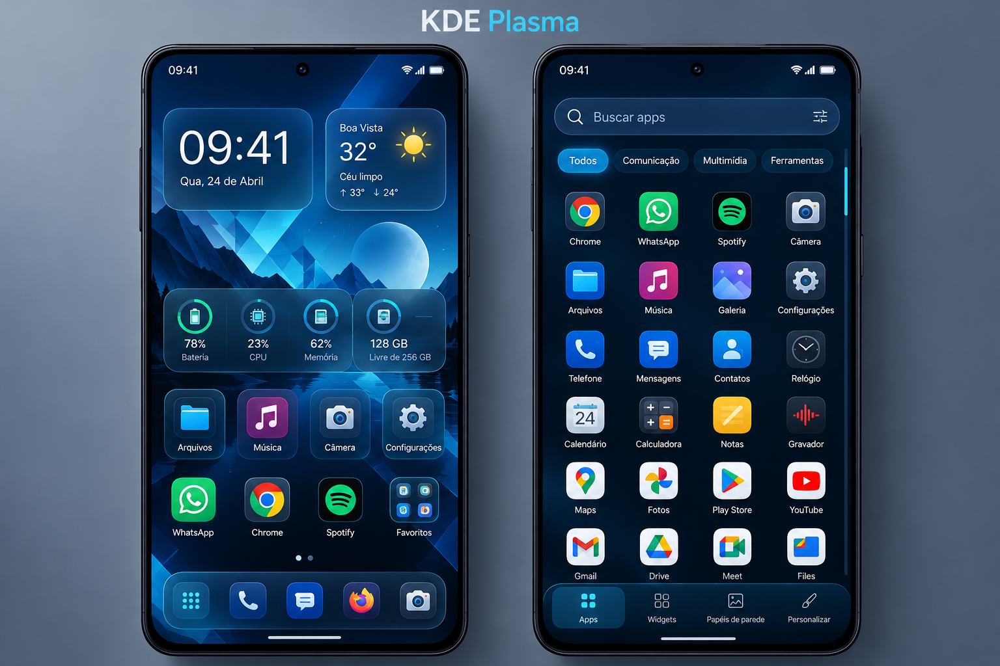
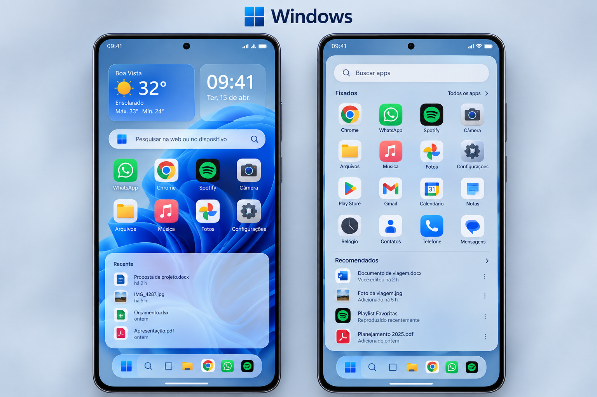
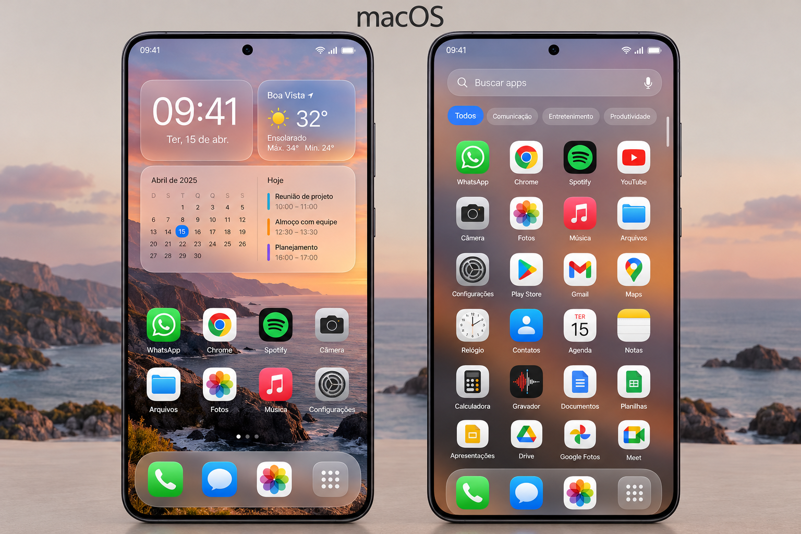
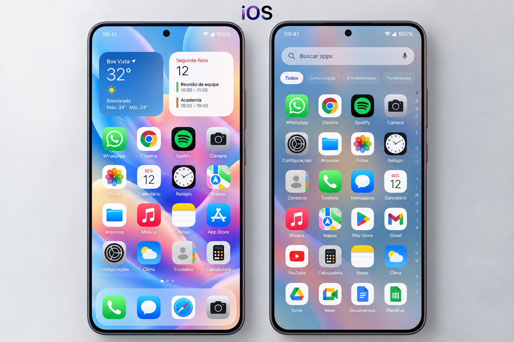

# Launcher Android com múltiplos temas

## Proposta

Criar um launcher Android que permita alternar entre experiências inspiradas em Ubuntu, KDE Plasma, Windows, macOS e iOS. Cada tema deve oferecer uma identidade própria, alterando cores, ícones, widgets, menus e organização dos aplicativos.

As imagens são conceitos visuais gerados por IA, não capturas de um aplicativo implementado. Dados de clima, datas, métricas e arquivos são ilustrativos; rótulos e detalhes podem precisar de ajustes no desenvolvimento. Os temas não significam executar esses sistemas no Android.

## Temas

| Tema | Identidade visual | Organização proposta |
| --- | --- | --- |
| Ubuntu | Roxo, laranja e painéis escuros | Dock lateral, favoritos e grade de aplicativos |
| KDE Plasma | Azul, ciano e painéis translúcidos | Widgets configuráveis, painel flutuante e apps por categoria |
| Windows | Azul e superfícies claras translúcidas | Menu Iniciar, aplicativos fixados e atalhos recentes |
| macOS | Paisagem, vidro e aparência suave | Dock, busca rápida e widgets de agenda |
| iOS | Cores suaves e ícones arredondados | Grade de aplicativos, widgets grandes e dock inferior |

## Diferencial

A troca de tema pode mudar também a forma de navegar: posição do dock, apresentação do menu de apps, gestos e disposição dos widgets. O usuário deve poder personalizar cada tema e preservar seus favoritos ao alternar.

## Primeira versão sugerida

- Tela inicial com favoritos e pastas.
- Lista de aplicativos instalados com busca.
- Seletor de temas com prévia.
- Configuração de papel de parede, tamanho dos ícones e grade.
- Dock configurável e suporte a widgets Android.
- Persistência das preferências e opção de definir como launcher padrão.

Começar com um tema completo, consolidar a navegação e depois adicionar os demais. Recursos como arquivos recentes e métricas do sistema devem ser avaliados conforme as APIs e permissões disponíveis; os mockups não garantem esses recursos.

## Galeria

Imagens em `docs/conceitos/`.

### Ubuntu

### KDE Plasma

### Windows

### macOS

### iOS

